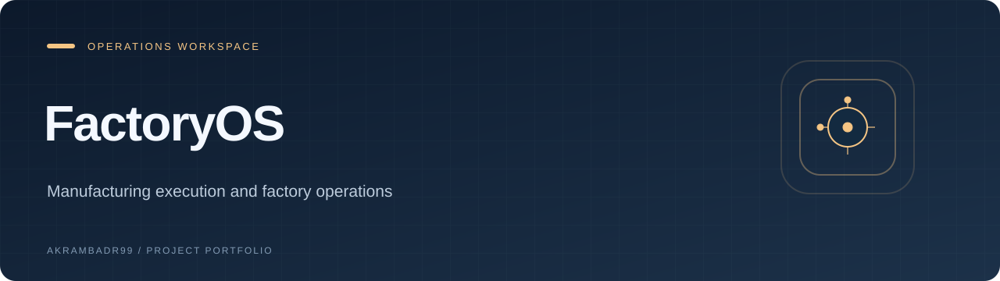
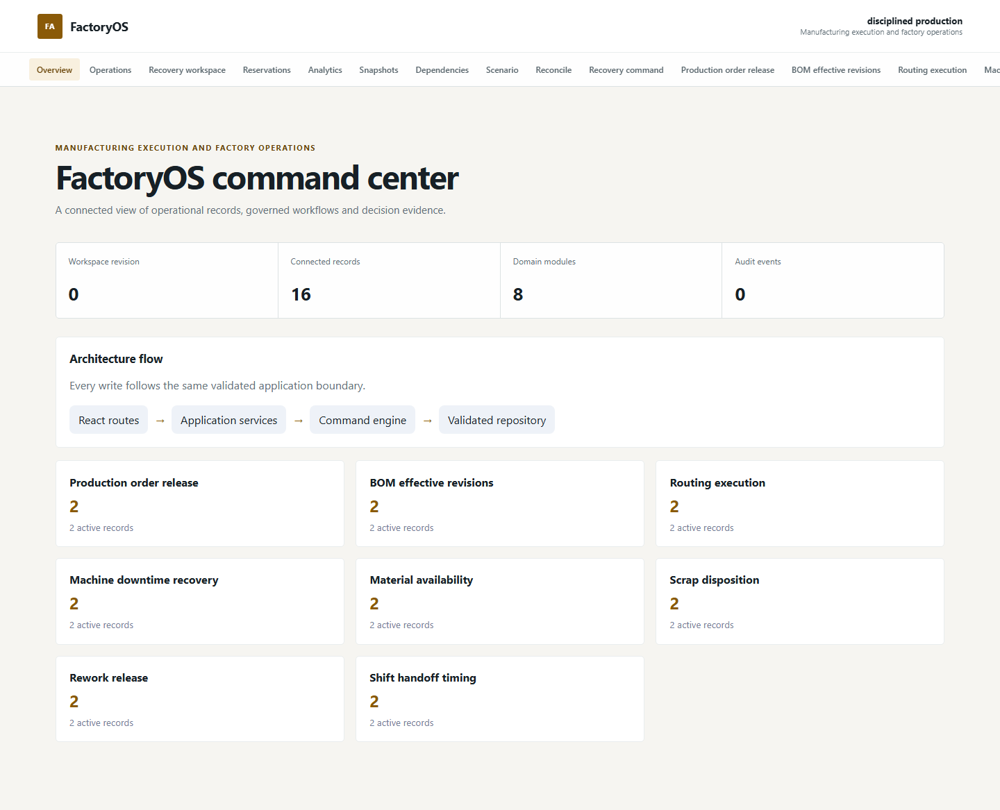

<p align="center">
  
</p>

<p align="center"><strong>Manufacturing execution and factory operations</strong></p>

<p align="center"><a href="#overview">Overview</a> · <a href="#explore">Explore</a> · <a href="#getting-started">Getting started</a></p>

<p align="center"><code>React</code> · <code>TypeScript</code> · <code>Vite</code></p>

## Overview

**FactoryOS** is a React and TypeScript application for manufacturing execution and factory operations. Explore its records, workflows, and operational views from the local workspace.

This project belongs to a related operations-application portfolio and shares foundation code and conventions with sibling repositories.



*Actual application capture using local fixture data.*

## AI code review and regression testing

I have used FactoryOS to evaluate AI-generated fixes and design debugging benchmarks across TypeScript workflows and a local Node.js/SQLite reservation service. The strongest cases require reasoning about concurrent commands, transactional writes, retries, and retained evidence.

- **Atomicity and conflict handling:** implemented revision-checked batch release and designed HTTP tests for competing updates and failures while recording receipts, so rejected commands cannot leave partial reservation or audit changes. [Batch-release tests](server/releaseBatchHttp.test.ts)
- **Recovery and migration checks:** tested replay after restart, checksum-confirmed migration, preservation of the original source, and refusal to overwrite existing state. [SQLite persistence tests](server/sqliteReservationStore.test.ts)
- **Evaluating candidate changes:** use these contracts to inspect whether a bug fix also preserves retry safety and existing workflow boundaries, and whether its tests exercise the failure rather than only the successful path.

The public tests provide reproducible review cases and support debugging-task design. The reservation service is local, inventory is simulated, and the service does not automatically control the browser application's execution gates.

Use the documented Node 24 runtime and installation steps below, then run the existing checks:

```sh
npm run check
npm run test:server
npm run test:e2e
```

`check` already includes server tests and builds. `test:server` is useful when reviewing a service change; `test:e2e` covers the browser and real local service journeys.

## Explore

- Production order release
- BOM effective revisions
- Routing execution
- Machine downtime recovery
- Material availability
- Scrap disposition
- Rework release
- Shift handoff timing

## Getting started

Use the project-specific instructions below. They include service configuration and persistence requirements; the frontend alone is not a substitute for those steps.

### Development commands

| Command | Script defined by this project |
| --- | --- |
| `npm run dev` | `vite` |
| `npm run typecheck` | `tsc -b` |
| `npm run lint` | `eslint . --max-warnings 0` |
| `npm run test` | `vitest run` |
| `npm run test:e2e` | `npm run build:server && playwright test` |
| `npm run build` | `npm run typecheck && vite build && node scripts/check-entry-budget.mjs` |

See the project guide below for browser installation and any service-specific setup.

## Project notes

The preview uses local fixture data. Workflow and role controls demonstrate application behavior; this page does not imply a certified, hosted, or production-integrated service.

<details>
<summary><strong>Project guide, technical details, and existing documentation</strong></summary>

# FactoryOS

Manufacturing execution and factory operations. A local-first React 19 operations platform with typed records, versioned commands, role-separated workflow transitions, cross-record validation, retry-safe receipts, immutable audit evidence, analytics, and direct Chromium journeys.

## Runtime

- Node 24.16+ within the Node 24 LTS line; npm 11.13.0
- Install with `npm ci --no-audit --no-fund`. Project configuration disables dependency lifecycle hooks; explicit application scripts still run. See the migration runbook before changing native dependencies or runtimes.
- `npm run check`
- `npm run test:e2e`

No external service is required. All deterministic fixtures and persistence adapters are local.

## Material reservations

An optional local Node service stores material holds, revision conflict state and retry receipts in a transactional SQLite database. Open **Reservations** in the product navigation. Inventory is explicitly simulated, and this separate ledger does not automatically release existing browser execution gates. Existing JSON ledgers require a reviewed preview and explicit checksum-confirmed migration; they are never automatically replaced.

See [the material reservation runbook](docs/material-reservations.md) for startup commands, persistence and recovery limits, workflow behavior and the next backend phases. `npm run check` validates the browser and server; `npm run test:e2e` includes real-service Chromium journeys.

See [the explicit SQLite migration procedure](docs/sqlite-reservation-migration.md) before upgrading an existing ledger, and [the SQLite phase validation report](docs/sqlite-reservations-validation.md) for measured results and remaining limits.

Order synchronization has a [read-only change review](docs/order-sync-review.md), removal acknowledgment and stale-source protection before explicit confirmation. This does not move browser order ownership to the service.

[Selected hold release](docs/selected-hold-release.md) lets planners review and release up to 25 explicitly chosen holds in one transaction, with a shared reason, preserved selection and exact retries. It never releases sync blockers automatically. See [the batch release validation report](docs/selected-hold-release-validation.md) for current checks and visual evidence; the [order review report](docs/order-sync-review-validation.md) retains the previous phase's results.

</details>

---

<p align="center"><a href="https://github.com/Akrambadr99?tab=repositories">Explore the portfolio</a></p>
